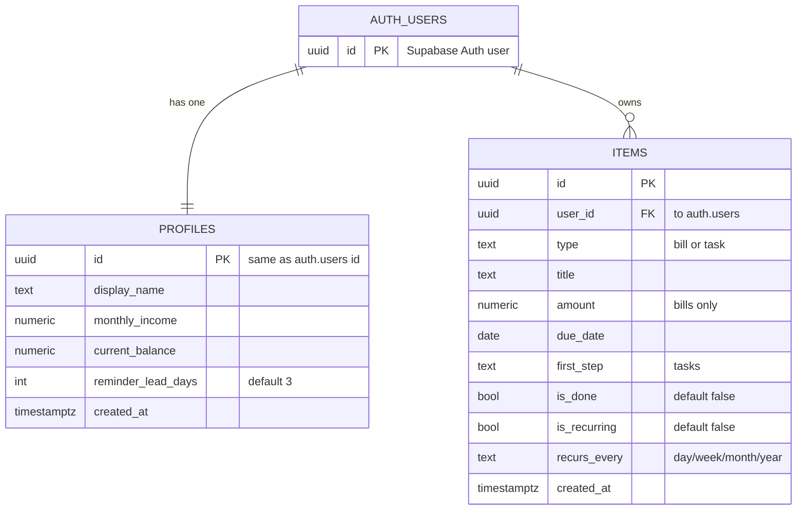

# Momentum — Database Diagram

A picture of the database: the tables, their columns, and how they connect.
(This is an **ER diagram** — Entity Relationship. GitHub renders the Mermaid block below as a diagram.)

The schema lives as migrations in [`supabase/migrations/`](../supabase/migrations):
`0001_init.sql` builds the tables, `0002_rls_policies.sql` adds the access rules.

## How to read it

- **`AUTH_USERS`** is Supabase's built-in accounts table (created for you when someone signs in). Your two tables hang off it.
- **`AUTH_USERS ||--|| PROFILES`** — **one user has exactly one profile.** A profile's `id` *is* the user's id, so a profile belongs to one person and no one else.
- **`AUTH_USERS ||--o{ ITEMS`** — **one user owns many items.** The little "crow's foot" (`o{`) means "many"; each item points back to its owner through `user_id`.
- **`items`** is the unified List: bills *and* tasks live in the same table, told apart by the `type` column (`bill` or `task`).

## The security angle

Both `profiles` and `items` link every row to a user (`id` / `user_id`). That link is
what **Row-Level Security** checks: a signed-in user can only read or change rows where
that id matches them. Combined with all database calls running on the server, that's the
app's two-lock security. See [`architecture.md`](architecture.md).
