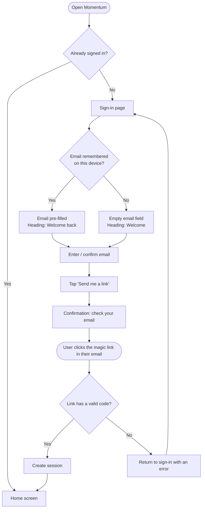
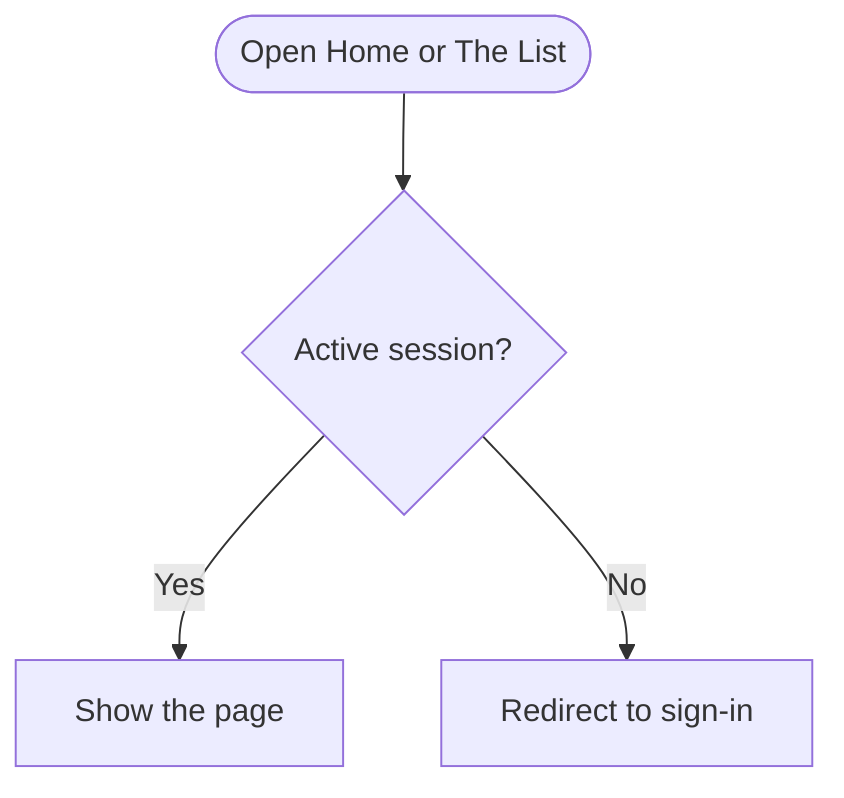
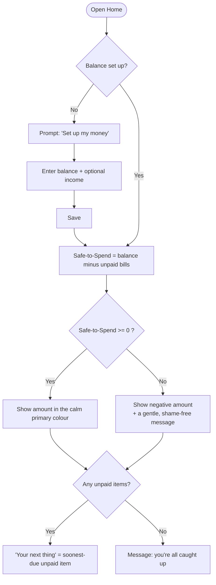
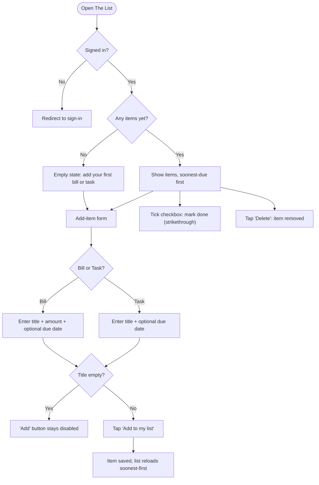
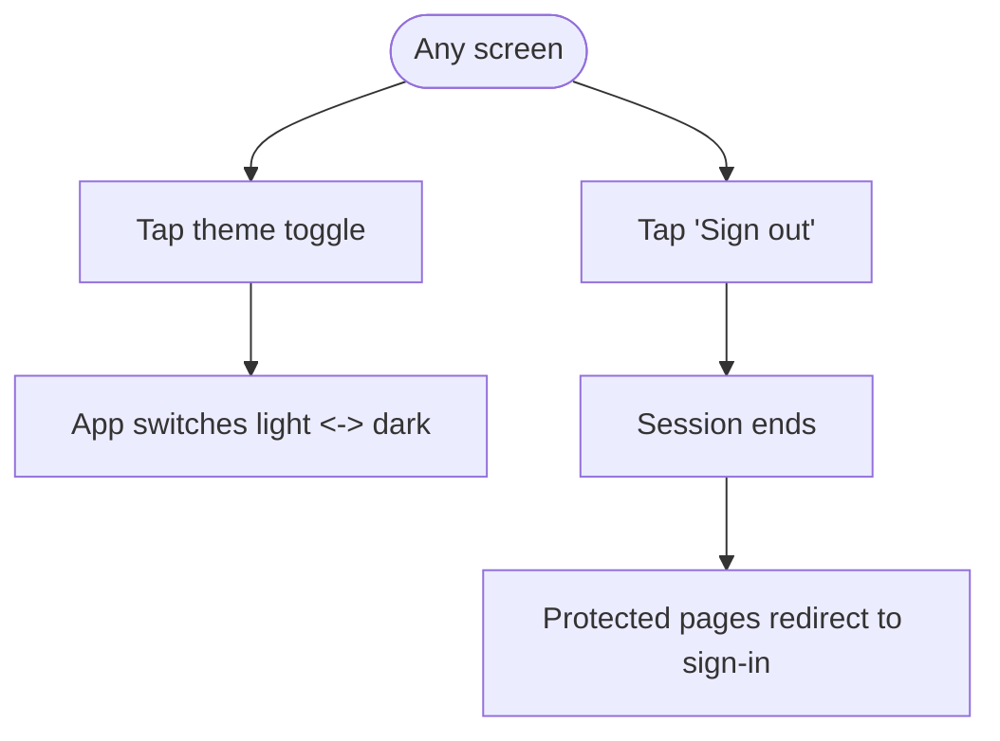

# Momentum — User Flows

Visual companions to [`use-cases-and-bdd.md`](./use-cases-and-bdd.md). Each flow is the
*map* of one feature's BDD scenarios: the paths a user takes and every decision point
(the yes/no forks). Diagrams are written in **Mermaid**, so they render automatically on
GitHub and in most Markdown previews.

How to read them: **rounded boxes** = where a flow starts or a key event happens,
**diamonds** = a decision, **rectangles** = a screen or action, **arrows** = what
happens next.

---

## Flow 1 — Passwordless sign-in

*Covers: "Passwordless sign-in" scenarios (UC-1).*

---

## Flow 2 — Protected pages (access guard)

*Covers: "Protected pages" scenarios — Home and The List require sign-in.*

---

## Flow 3 — Home: Safe-to-Spend + your next thing

*Covers: "Safe-to-Spend on Home" and "Your next thing" scenarios (UC-2, UC-3).*

---

## Flow 4 — The List: add, complete, delete

*Covers: "The List" scenarios (UC-4, UC-5, UC-6).*

---

## Flow 5 — Theme + sign out

*Covers: "Theme and sign-out" scenarios (UC-7, UC-8).*

---

*These flows and the BDD scenarios describe the same behaviour from two angles — keep
them in sync when the app changes.*
